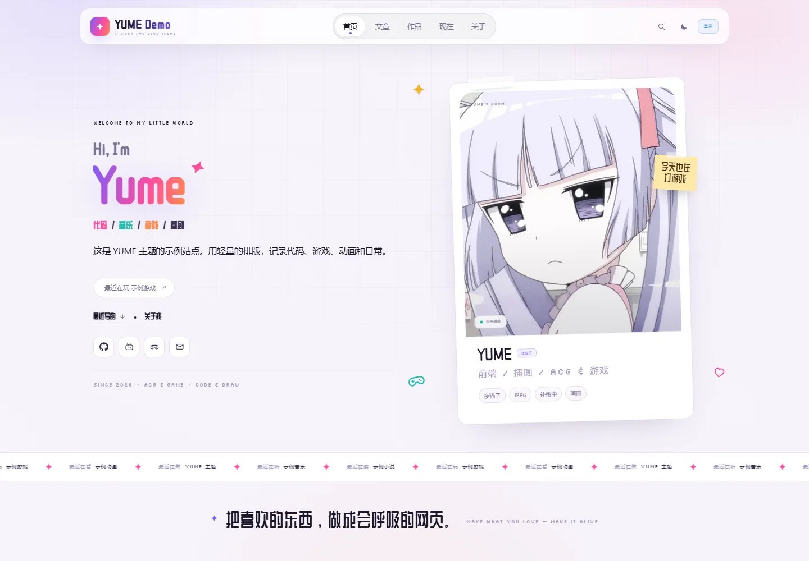
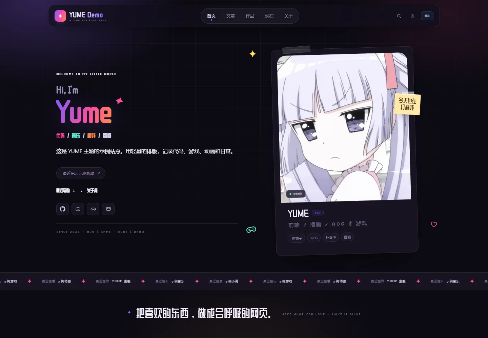
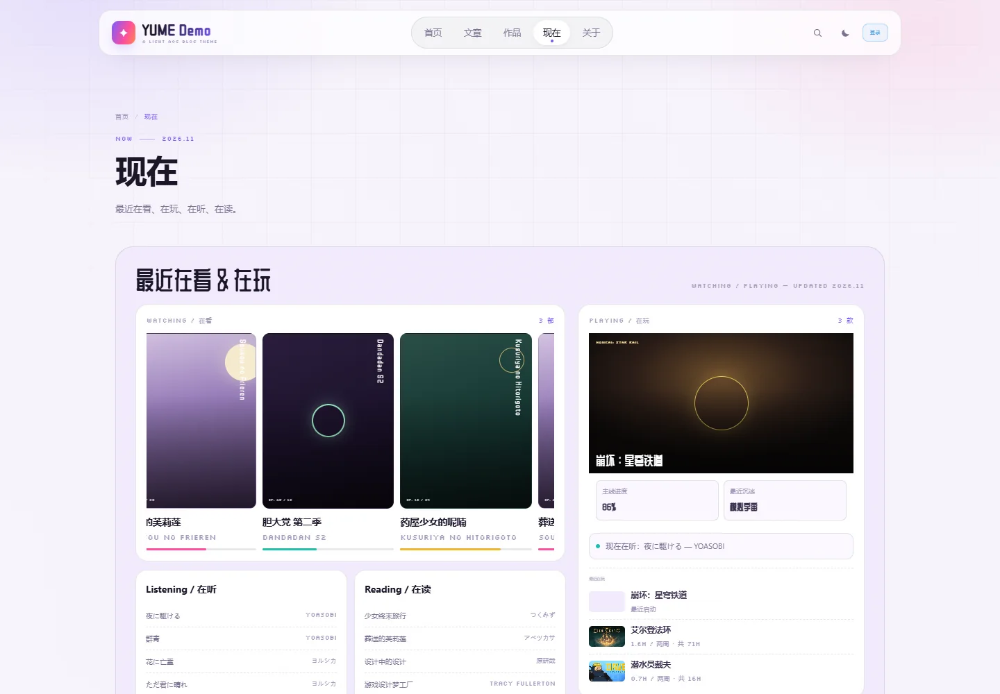
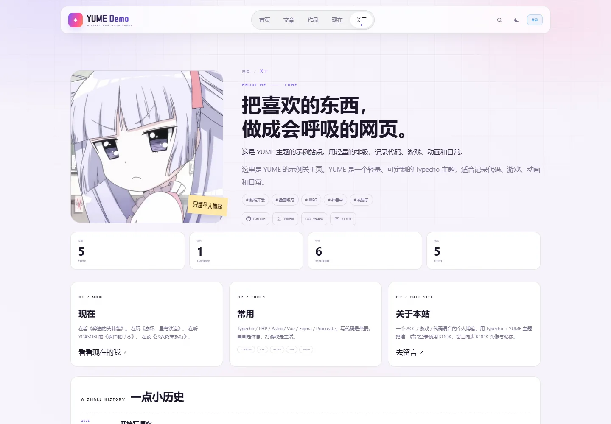
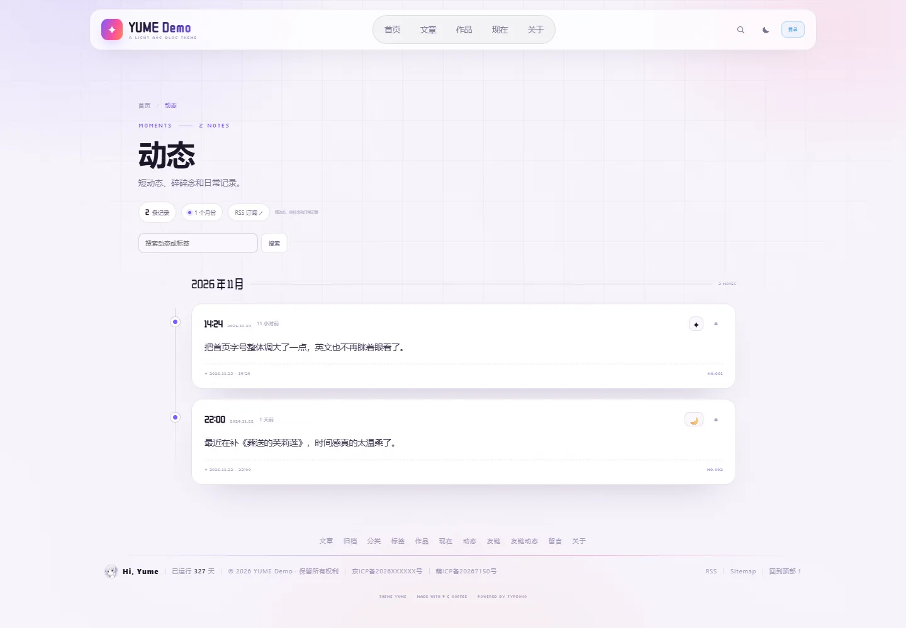

# YUME

> 一个面向 ACG / 游戏 / 代码个人博客的 Typecho 主题

YUME 是一个轻量、可定制、偏二次元气质的 Typecho 主题。默认浅色，支持深色模式、KOOK 登录、Steam / Bilibili / 网易云 / GitHub 数据、动态、友链、归档热力图、图片灯箱、阅读进度、代码高亮和 PWA。

当前版本：**1.0.0**


## 展示说明

本仓库 `main` 分支仅用于展示主题效果。

- 不包含主题源代码
- 不包含 YumePanel 源代码
- 不包含部署配置
- 截图使用独立的 `YUME Demo` 示例站点生成，不包含个人站点数据

源代码位于私有仓库 `aayorishy/Typecho-Yume-Dev`，不在公开仓库发布。

## 特性

- 浅色 / 深色 / 跟随系统
- 薰衣草紫 + 粉色 ACG 视觉
- 响应式布局，移动端底部导航
- 首页 Hero / 文章 / 作品 / 现在 / KOOK / 关于
- 文章阅读进度、目录、代码高亮、代码复制
- 图片灯箱、画廊切换、图片说明
- 脚注、边注、剧透折叠
- 归档写作热力图
- 标签云权重
- 随机文章
- KOOK 登录、KOOK 头像 / 昵称
- KOOK 社区小工具
- Steam 最近游戏
- Bilibili 追番
- 网易云在听
- GitHub 作品
- 友链申请 / 审核 / 管理
- 动态时间线
- 个人资料编辑
- PWA manifest / Service Worker / 离线页
- 原生 Typecho 外观设置，分类面板，单保存按钮
- 本地字体子集
- 本地 Prism，不依赖外部 CDN

## 截图

| 首页 | 深色 |
| --- | --- |
|  |  |

| 文章 | 现在 |
| --- | --- |
|  |  |

| 关于 | 动态 |
| --- | --- |
|  |  |

| 后台设置 |
| --- |
|  |

| 移动端 |
| --- |
|  |

## 环境

- Typecho **1.3+**
- PHP **8.1+**
- 推荐 PHP 8.3 / 8.4
- 推荐开启 OPcache
- 推荐 Nginx 或 Apache
- KOOK 登录需要 **MoePanel**
- YumePanel 是主题配套插件，负责友链与动态

## 安装

完整安装说明、部署配置和源代码位于私有开发仓库：

```text
aayorishy/Typecho-Yume-Dev
```

`main` 分支不提供代码下载。

## 字体

展示与开发版本只使用：

```text
ZCOOLQingKeHuangYou-Regular
Silkscreen
```

正文使用系统无衬线字体。

## 版权

代码 © aayorishy。

主题内字体、KOOK 图标、Steam / Bilibili / 网易云 / GitHub 数据归各自权利人所有。
