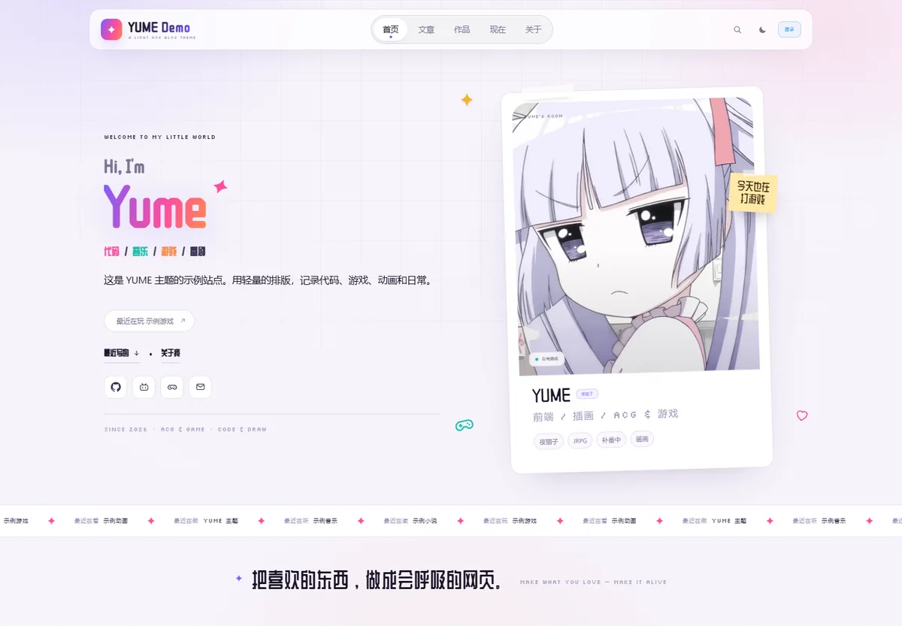
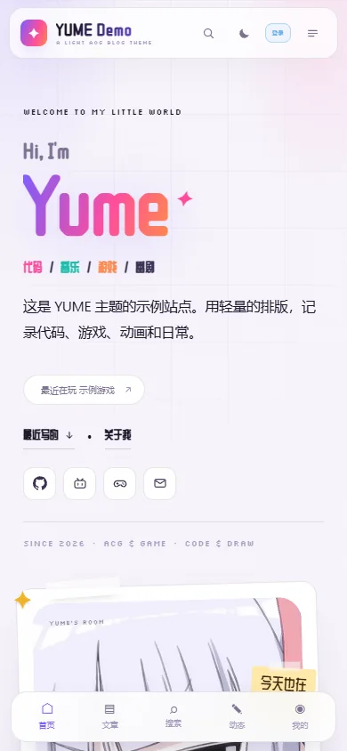
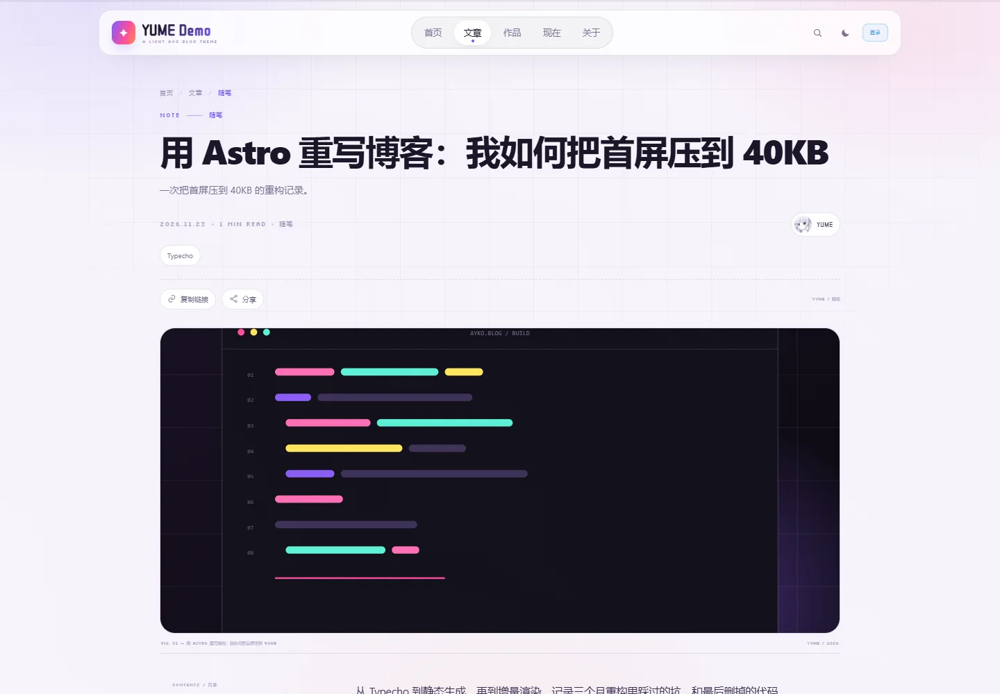
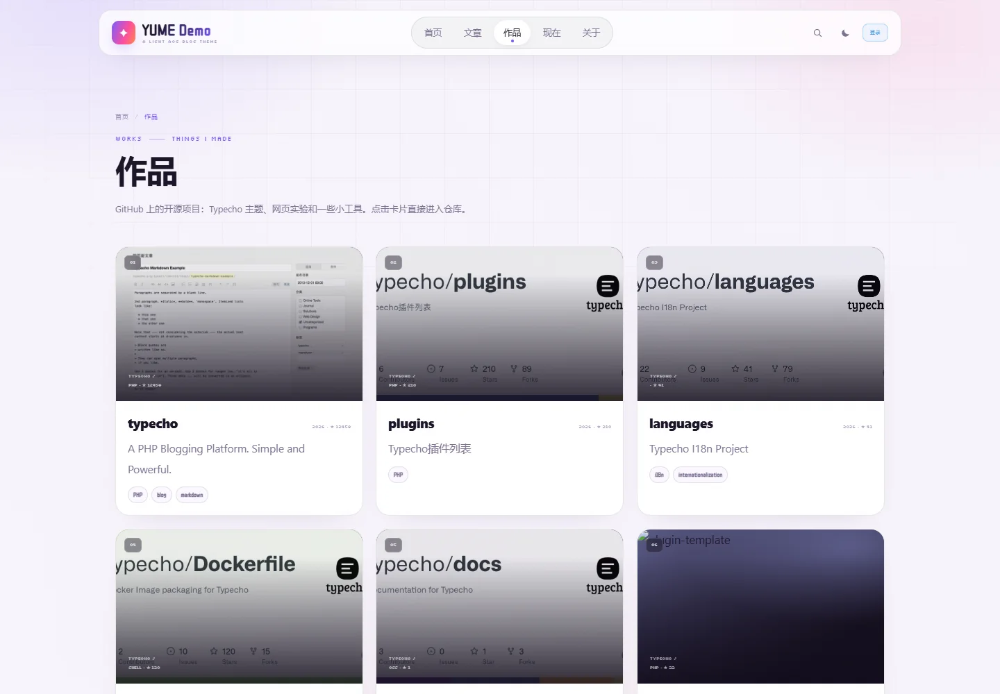
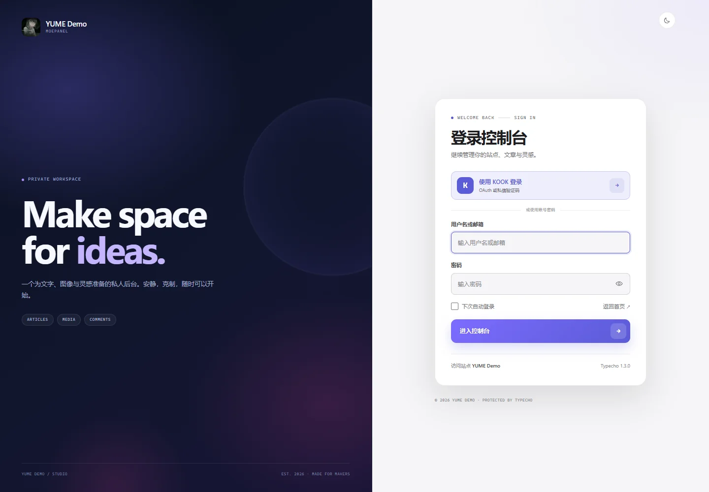

# YUME

> 一个面向 ACG / 游戏 / 代码个人博客的 Typecho 主题

YUME 是一个轻量、可定制、偏二次元气质的 Typecho 主题。默认浅色，强调薰衣草紫与粉色纸感排版，适合记录文章、作品、游戏、动画与日常。

当前版本：**1.0.0**



## 展示说明

本仓库 `main` 分支仅用于展示主题效果。

- 不包含主题源代码
- 不包含 YumePanel 源代码
- 不包含部署配置
- 截图使用独立的 `YUME Demo` 示例站点生成
- 所有截图均为默认浅色模式
- 不包含个人站点数据

源代码位于私有仓库：

```text
aayorishy/Typecho-Yume-Dev
```

## 主题特性

### 页面与内容

- 首页 Hero、文章、作品、现在、KOOK、关于
- 文章阅读进度、目录、上一篇 / 下一篇
- 图片灯箱、画廊切换、图片说明
- 代码高亮、代码复制、代码行号
- 脚注、边注、剧透折叠
- 归档写作热力图
- 标签云权重
- 随机文章
- 友链申请、审核与管理
- 动态时间线
- 个人资料编辑
- 作品页 GitHub 截图封面
- 作品页每 6 个一组，按钮加载更多

### 外观

- 默认浅色，支持深色与跟随系统
- 薰衣草紫 + 粉色 ACG 视觉
- 响应式布局
- 移动端底部导航
- 可配置内容宽度、圆角、密度、字号
- 自定义 CSS / JavaScript
- 原生 Typecho 外观设置分类面板
- 单保存按钮，保存后即时生效

### 数据与登录

- KOOK 登录：昵称#编号 / 用户 ID / OAuth2
- KOOK 头像与昵称
- KOOK 社区小工具
- Steam 最近游戏
- Bilibili 追番
- 网易云在听
- GitHub 作品
- 友链 Feed 检测
- 动态图片上传

### 性能与 SEO

- 字体子集化（WOFF2）
- ZCOOL 庆科黄油体 + Silkscreen 像素体
- 本地 Prism，不依赖外部 CDN
- 图片懒加载
- CSS / JS 版本号缓存
- PWA manifest / Service Worker / 离线页
- canonical
- Open Graph / Twitter Card
- Article JSON-LD
- BreadcrumbList
- RSS / sitemap
- 文章发布时间 / 修改时间
- favicon / apple-touch-icon
- 清理重复的 Typecho head 输出

## 截图

| 首页 | 移动端 |
| --- | --- |
|  |  |

| 文章 | 作品 |
| --- | --- |
|  |  |

| 现在 | 关于 |
| --- | --- |
|  |  |

| 动态 | 后台设置 |
| --- | --- |
|  |  |

## 环境要求

- Typecho **1.3+**
- PHP **8.1+**
- 推荐 PHP 8.3 / 8.4
- 推荐开启 OPcache
- 推荐 Nginx 或 Apache
- KOOK 登录需要 MoePanel
- YumePanel 是主题配套插件

## 安装

完整安装说明、源代码和部署配置位于私有开发仓库：

```text
aayorishy/Typecho-Yume-Dev
```

安装目录：

```text
usr/themes/yume/
usr/plugins/YumePanel/
/sw.js
```

启用顺序：

1. 后台 → 外观 → 启用 YUME
2. 后台 → 插件 → 启用 YumePanel
3. 后台 → 外观 → 设置外观 → 保存设置
4. 将 `theme/sw.js` 复制到站点根目录

## 外观设置

```text
站点身份
首页第一眼
关于与资料
外观配色
字体排版
首页模块
作品页
页脚与备案
社交与登录
外部数据
高级
```

自定义 CSS / JavaScript 在「高级」中。

## 作品页

GitHub 项目封面优先级：

```text
后台自定义截图
  ↓
GitHub README 第一张图片
  ↓
GitHub OpenGraph 封面
  ↓
主题渐变卡片
```

后台「作品页」支持：

- 选择显示哪些 GitHub 项目
- 调整项目顺序
- 配置自定义截图 URL
- 自定义截图优先于 GitHub README

作品页初始显示 6 个，点击「加载更多」显示下一组。

## KOOK 登录

KOOK 登录由 MoePanel 提供：

- 验证码登录
- OAuth2 登录
- 站主 KOOK ID 映射到 Typecho 管理员
- 普通 KOOK 用户只拥有留言权限
- 普通用户不创建 Typecho 账号

验证码登录失败时检查：

```text
usr/yume-kook-auth.log
```

服务器外账号建议使用 OAuth2。

## 字体

主题只使用：

```text
ZCOOLQingKeHuangYou-Regular.subset.woff2
Silkscreen-Regular.subset.woff2
Silkscreen-Bold.subset.woff2
```

- ZCOOL：标题与展示文字
- Silkscreen：像素标签与英文小字
- 正文：系统无衬线字体

## 目录结构

```text
Typecho-Yume/
├── README.md
├── LICENSE
├── CHANGELOG.md
├── VERSION
├── .gitignore
└── docs/
    └── screenshots/
        ├── home.webp
        ├── cover.webp
        ├── article.webp
        ├── works.webp
        ├── now.webp
        ├── about.webp
        ├── moments.webp
        ├── settings.webp
        └── home-mobile.webp
```

## 兼容性

- Typecho 1.3
- PHP 8.1+
- SQLite / MySQL
- 现代浏览器
- 深色模式
- `prefers-reduced-motion`

## 更新日志

见 [CHANGELOG.md](CHANGELOG.md)。

## 致谢

- Typecho
- MoePanel
- 所有字体作者

## 版权

代码 © aayorishy。

主题内字体、KOOK 图标、Steam / Bilibili / 网易云 / GitHub 数据归各自权利人所有。
